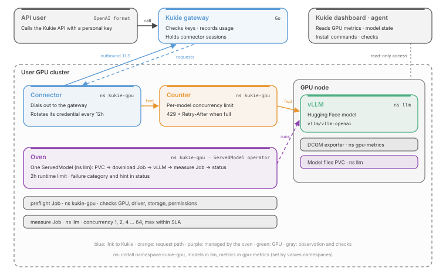
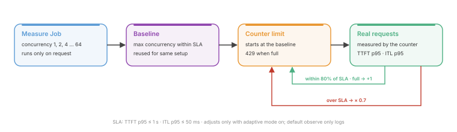
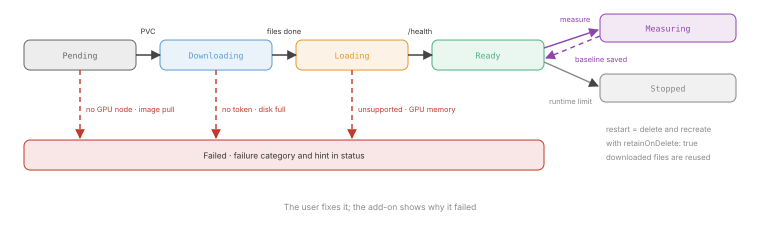

# Kukie GPU Operator

[한국어](README.md) · **English**

Helm add-on that plugs Kukie serving into your own GPU cluster.

<p align="center"></p>

- **Observe**: GPU utilization, memory and power, plus vLLM queue and KV cache, shown in the Kukie dashboard
- **Measure**: highest concurrency that stays within the SLA (TTFT p95 ≤ 1 s, ITL p95 ≤ 50 ms)
- **Serve**: one Hugging Face model name takes care of download, vLLM startup and status reporting
- **Connect**: a connector inside the cluster dials out to Kukie. No public address or open port needed to call the model through the Kukie API

Runbooks are written in Korean.

## Components

<p align="center"></p>

| Component | Path | Role | Docs |
| --- | --- | --- | --- |
| Chart | `charts/kukie-gpu` | Installs everything below in one release. Observation and checks by default, the rest only when enabled | [gpu-view](runbooks/gpu-view.md) |
| Oven | `oven` | One `ServedModel` drives storage → download → vLLM → status. Includes a runtime limit, measurement and failure classification | [oven](runbooks/oven.md) |
| Counter | `counter` | Front door for the model. Key check, per-model concurrency limit, 429 when full | [counter](runbooks/counter.md) |
| Connector | `connector` | Keeps the connection to the Kukie gateway, forwards requests to the counter, rotates its own credential | [connector](runbooks/connector.md) |

- Namespaces: oven, counter, connector and preflight live in the install namespace (`kukie-gpu`); ServedModels, vLLM and measure Jobs in `llm`; DCGM in `gpu-metrics`. Change them with `namespaces` in `values.yaml`
- Create ServedModels in `llm`. The oven ignores ServedModels in other namespaces

Split into three layers by permission and install order. Each layer can be installed on its own.

| Layer | Contents | Cluster permission |
| --- | --- | --- |
| 1 Observe | DCGM exporter, Kukie read RoleBinding, preflight | Read only |
| 2 Measure | Measurement Job (runs only when a person starts it, with a time limit) | Create Jobs in the namespace |
| 3 Serve | Oven, counter, connector | Write in the namespace |

## Concurrency limit

<p align="center"></p>

- Measurement Job: raises concurrency 1, 2, 4 … 64 and records TTFT and ITL. Fills the GPU, so it only runs when someone presses the button
- Baseline: the highest concurrency that met the SLA. Reused when a record exists for the same model, GPU and settings
- Counter: uses the baseline as the starting limit. Requests above the limit get 429
- Adaptive limit (`counter.discovery.adaptive.mode=on`): raises the limit by 1 or cuts it to 0.7× based on real request latency. The default, `observe`, only logs the decision

## Model states

<p align="center"></p>

- `Failed` records the failure category and a hint in status. The user fixes it; the add-on shows why
- To restart a `Stopped` model, delete and recreate the ServedModel. With `spec.storage.retainOnDelete: true` the downloaded files are reused; with the default `false` the PVC goes too and the model is downloaded again. Models created from the Kukie dashboard use `true`

## Install

- Chart and images are public GHCR packages. No login needed
- Issue the connector credential in the Kukie dashboard (Key management → Connection). The same screen shows these commands with your cluster ID and gateway address filled in
- The credential goes in a Secret, not in values. It never lands in the Helm release, and the connector swaps it for a new one on first connect

```sh
kubectl create namespace kukie-gpu
read -rs CREDENTIAL && kubectl -n kukie-gpu create secret generic kukie-connector \
  --from-literal=credential="$CREDENTIAL" && unset CREDENTIAL
helm upgrade --install kukie-gpu oci://ghcr.io/durokukie/charts/kukie-gpu --version 0.15.0 -n kukie-gpu \
  --set oven.enabled=true --set counter.enabled=true --set counter.discovery.enabled=true \
  --set connector.enabled=true \
  --set connector.gateway=https://<kukie-host>/connector/v1/connect \
  --set connector.clusterId=<cluster-id>
```

## Repository

| Path | Contents |
| --- | --- |
| `charts/kukie-gpu` | Helm chart |
| `oven`, `counter`, `connector` | Three Go programs, each with its own CI (`oven.yml`, `counter.yml`, `connector.yml`) |
| `kubernetes`, `scripts` | YAML that used to be applied by hand, chart render comparison, chart tests |
| `runbooks` | Install and operation procedures |
| `history` | Records of changes applied to our cluster |

- Release: tagging `v<chart version>` publishes the three images and the chart to GHCR together
- Terraform and measurement scripts for our own GPU cluster live in [kukie-gpu-infra](https://github.com/durokukie/kukie-gpu-infra). This repository holds only what gets installed in user clusters

## Remaining work

- Real test of Karpenter creating and removing GPU nodes
- Karpenter NodePool check in preflight. Needs cluster read permission
- Streaming through the counter with the OpenAI SDK. Checked only with curl and a load script so far
- Adaptive limit
  - Limit keeps dropping on long inputs
  - Occasional latency spikes only through the counter (ITL p95 40 ms). Cause unknown
  - The fix that stops raising the limit when TTFT samples are few is not yet load-tested
- `spec.admission` on ServedModel (sidecar admission proxy) is a field only and does nothing. The counter is the front door for now
- The connector on `kukie-gpu` is still deployed by hand, not yet through the chart
- Out of scope: multi-node models, engines other than vLLM, serving several models at once, automatic model file cleanup
