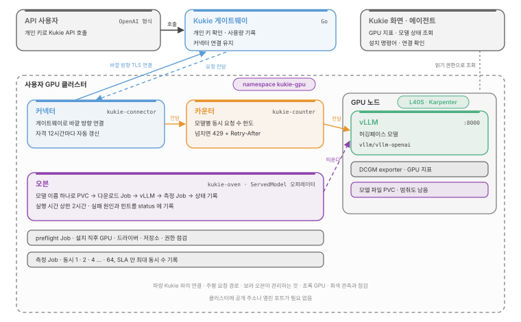
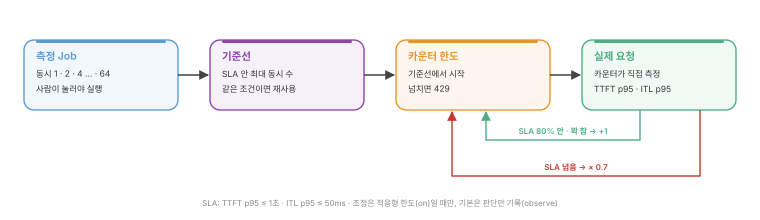
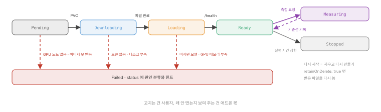

# Kukie GPU 애드온

사용자 GPU 클러스터에 Helm으로 끼우는 Kukie 서빙 애드온.

- **관측**: GPU 사용률·메모리·전력과 vLLM 대기 요청·KV 캐시를 Kukie 화면에 표시
- **측정**: SLA(TTFT p95 ≤ 1초, ITL p95 ≤ 50ms) 안에서 받을 수 있는 최대 동시 요청 수 측정
- **서빙**: 허깅페이스 모델 이름 하나로 다운로드부터 vLLM 기동, 상태 기록까지 처리
- **연결**: 클러스터 안 커넥터가 Kukie로 먼저 연결. 공개 주소나 열린 포트 없이 Kukie API로 호출 가능

## 구성

<p align="center"></p>

| 부품 | 경로 | 역할 | 문서 |
| --- | --- | --- | --- |
| 차트 | `charts/kukie-gpu` | 아래 부품 전부를 한 번에 설치. 기본은 관측과 점검만, 나머지는 켤 때만 설치 | [gpu-view](runbooks/gpu-view.md) |
| 오븐 | `oven` | `ServedModel` 하나로 저장소 → 다운로드 → vLLM → 상태 기록. 실행 시간 상한, 측정, 실패 원인 분류 포함 | [oven](runbooks/oven.md) |
| 카운터 | `counter` | 모델 앞 입구. 키 확인, 모델별 동시 요청 수 제한, 넘치면 429 | [counter](runbooks/counter.md) |
| 커넥터 | `connector` | Kukie 게이트웨이와의 연결 유지, 받은 요청을 카운터로 전달, 자격 자동 갱신 | [connector](runbooks/connector.md) |

권한과 설치 순서에 따라 세 층으로 구분. 층마다 따로 설치 가능.

| 층 | 들어가는 것 | 클러스터 권한 |
| --- | --- | --- |
| 1층 관측 | DCGM exporter, Kukie 읽기 RoleBinding, preflight | 읽기만 |
| 2층 측정 | 측정 Job (사람이 눌러야 실행, 시간 상한 있음) | namespace 안 Job 생성 |
| 3층 서빙 | 오븐, 카운터, 커넥터 | namespace 안 쓰기 |

## 측정에서 한도까지

띄우기만 하는 도구는 많지만, 얼마까지 받을지를 실측에서 정하는 도구는 드묾. 이 애드온의 핵심 루프.

<p align="center"></p>

- 측정은 GPU를 가득 채우므로 사람이 눌러야 실행
- 같은 모델·GPU·설정의 측정 기록이 있으면 다시 재지 않고 재사용
- 측정값은 요청 모양(입력 1000 · 출력 200)에 맞춘 시작값. 실제 한계는 카운터가 실제 요청을 보며 조정
- 카운터 조정은 적응형 한도(`counter.discovery.adaptive.mode=on`)를 켰을 때만 동작. 기본은 판단만 기록하는 `observe`

## 모델 상태

<p align="center"></p>

- `Failed`에는 원인 분류와 힌트를 status에 기록. 고치는 건 사용자, 원인을 보여 주는 건 애드온 몫
- `Stopped`여도 모델 파일(PVC)은 남아 다시 띄울 때 재다운로드 없음

## 설치

- 차트와 이미지는 GHCR 공개 패키지. 로그인 없이 설치 가능
- 커넥터 자격은 Kukie 화면(키 관리 → 연결 설정)에서 발급. 같은 화면에 클러스터에 맞춘 명령어 표시
- 자격은 values가 아닌 Secret으로 전달. helm 기록에 원문이 남지 않고, 커넥터가 처음 붙을 때 새 자격으로 교체

```sh
kubectl create namespace kukie-gpu
read -rs CREDENTIAL && kubectl -n kukie-gpu create secret generic kukie-connector \
  --from-literal=credential="$CREDENTIAL" && unset CREDENTIAL
helm upgrade --install kukie-gpu oci://ghcr.io/durokukie/charts/kukie-gpu --version 0.15.0 -n kukie-gpu \
  --set oven.enabled=true --set counter.enabled=true --set counter.discovery.enabled=true \
  --set connector.enabled=true \
  --set connector.gateway=https://<Kukie 주소>/connector/v1/connect \
  --set connector.clusterId=<클러스터 ID>
```

## 저장소

| 경로 | 내용 |
| --- | --- |
| `charts/kukie-gpu` | Helm 차트 |
| `oven`, `counter`, `connector` | Go 프로그램 세 개. 각자 CI(`oven.yml`, `counter.yml`, `connector.yml`) |
| `kubernetes`, `scripts` | 예전에 손으로 apply 하던 YAML, 차트 렌더 비교 스크립트, 차트 시험 |
| `runbooks` | 설치·운영 절차 |
| `history` | 우리 클러스터 적용 기록 |

- 릴리스: 태그 `v<차트 버전>`을 달면 이미지 세 개와 차트를 함께 GHCR에 게시
- 우리 GPU 클러스터의 Terraform과 측정 스크립트는 [kukie-gpu-infra](https://github.com/durokukie/kukie-gpu-infra)에 있음. 이 저장소에는 사용자 클러스터에 설치되는 것만 둠

## 아직 안 된 것

- Karpenter로 GPU 노드가 뜨고 내려가는 실제 시험
- preflight의 Karpenter NodePool 검사 (클러스터 읽기 권한 추가 필요)
- 실제 OpenAI SDK로 카운터를 거친 스트리밍 확인 (지금까지는 curl과 자체 부하 스크립트)
- 카운터 한도 조절의 남은 문제
  - 긴 입력에서 한도가 연달아 내려가는 현상
  - 카운터를 거칠 때만 가끔 튀는 지연
- 우리 클러스터 `kukie-gpu`의 커넥터를 차트로 이전 (지금은 손으로 올린 것)
- 범위 밖: 여러 노드에 걸친 모델, vLLM 외 엔진, 모델 여러 개 동시 서빙, 모델 파일 자동 정리
